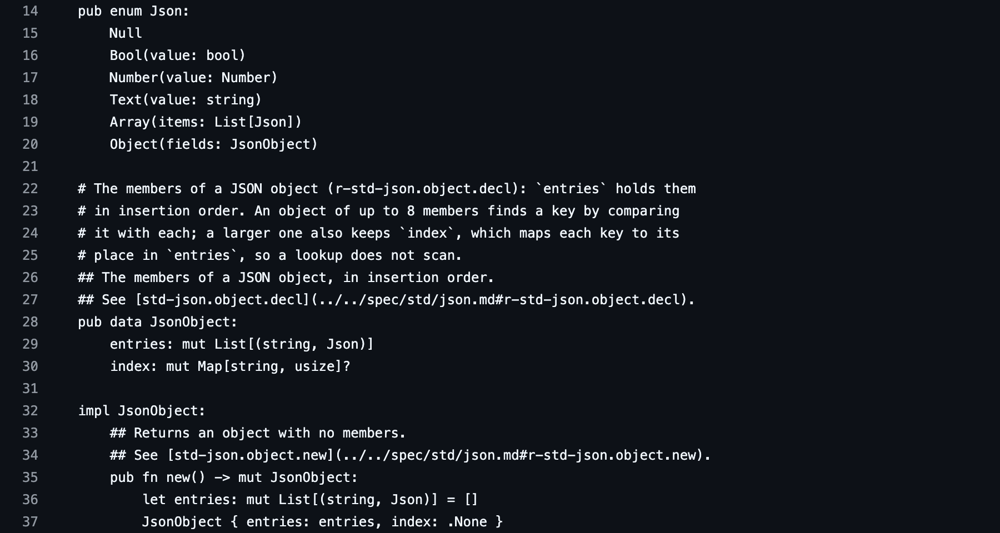
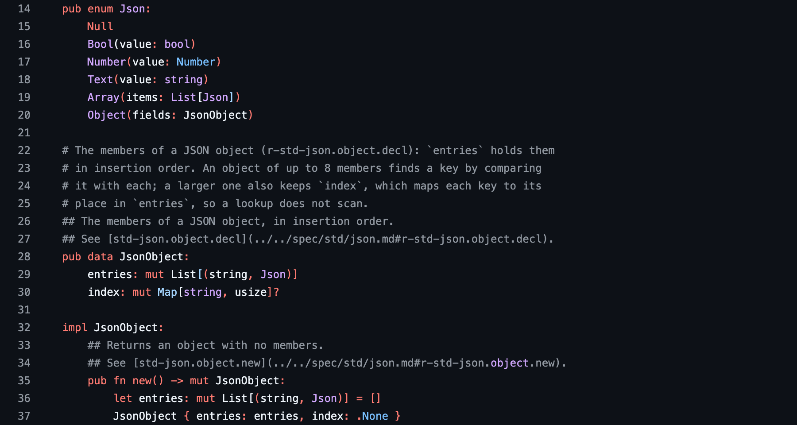

<p align="center">
  
</p>

# Universal GitHub Highlighting

Syntax highlighting for the languages GitHub doesn't recognize yet.

Trying out a new language, building your own, or reading code generated by AI? This Chrome extension adds colors automatically when GitHub leaves the code plain. No language selection or configuration needed.

GitHub's existing highlighting stays as it is. Line links, copying, code navigation, and pull request interactions keep working, and colors follow your light or dark theme.

## Before and after

The same [HD source file](https://github.com/HerringtonDarkholme/hd-lang/blob/main/lib/std/json.hd), with highlighting off and on. These are real GitHub captures; the source text stays unchanged.

**Before — GitHub's plain rendering**



**After — automatic GPU highlighting**



## Install

You'll need a recent desktop Chrome with WebGPU support and Node.js 22 or newer to build the extension.

```sh
git clone https://github.com/HerringtonDarkholme/github-gpu-highlighting.git
cd github-gpu-highlighting
npm ci
npm run build
```

1. Open `chrome://extensions` and turn on **Developer mode**.
2. Choose **Load unpacked** and select the `dist` folder.
3. Open a file on GitHub. Reload any GitHub tabs that were already open.

## Use it

Browse GitHub as usual. Highlighting works in repository files, pull request diffs, and Markdown code blocks, including when you navigate between files without reloading.

Click the extension's icon to turn highlighting on or off for all GitHub tabs. If a file stays plain, choose **Force highlight** next to it in the popup. That choice lasts until you navigate away or turn the extension off, and can override GitHub's colors for that file.

Adjust **Color transition** in the popup to change the color fade duration (420 ms by default). Set it to 0 for instant colors. The setting is saved for all GitHub tabs and applies to the next transition. Choose **Stop forcing** to return a file to automatic highlighting.

## Your code stays on your device

All highlighting runs locally on your GPU. The model comes bundled with the extension: no code uploads, external services, accounts, or telemetry.

Read the [privacy policy](PRIVACY.txt) for details about local code processing, saved preferences, and temporary caches.

## How it works

The extension checks whether GitHub has already colored the code. When it hasn't, a small [gpu-lexer](https://github.com/vercel-labs/gpu-lexer) model predicts syntax colors directly from the text, without needing to know its programming language. The extension applies colors as soon as the model returns, without changing the source. CSS handles the fade; there is no extra wait before applying the result.

GitHub can load and remove code rows as you scroll. The extension reads the full source already present on the page and caches its token positions. Newly displayed rows reuse that result, so scrolling doesn't rerun the model or restart the fade.

Colors use the [CSS Custom Highlight API](https://developer.mozilla.org/en-US/docs/Web/API/CSS_Custom_Highlight_API): the model returns text ranges, and `::highlight()` styles them while GitHub keeps its own code elements. When highlighting appears, `color-mix()` blends the original text color into the syntax color. A CSS transition on each code block fades all its lines together over 420 ms by default, including lines offscreen. Scrolling does not start a new fade. Turning highlighting off fades back to the original colors before removing the highlight ranges. When GitHub replaces a code block during startup, the extension rebinds its colors to the new text nodes, preserving completed colors or continuing an active fade from the same point. Reduced-motion preferences skip the animation.

The GPU model starts in a hidden background page when you visit GitHub. All GitHub tabs share it, so opening another file or reloading a page doesn't initialize the model again. Each page keeps its own cache, and a small extension memory cache preserves recent results across reloads. For an immediate same-tab reload, a one-use snapshot in the tab's session storage lets the new document restore matching colors before its first paint. The snapshot expires after five seconds; the extension memory cache clears when the browser closes. Three minutes after the last GitHub tab closes or leaves GitHub, the background page unloads to release GPU memory. Returning during that time keeps it ready; turning the extension off releases it immediately.

## If something stays plain

- **Try Force highlight.** The extension is conservative about preserving GitHub's colors, even if only part of a file is highlighted.
- **Check the popup for GPU errors.** If WebGPU is unavailable or initialization fails, the original page stays intact. Turn highlighting off and back on to retry.
- **Expand the code first.** Collapsed or unloaded diff sections are processed when GitHub displays them.
- **Very large files are skipped.** The limit is about 120,000 characters per file or block, with a total processing budget of about 240,000 per page. Force highlighting uses the same limits.

The first file can take a moment while the GPU starts. The model can also get colors wrong, especially around omitted diff context. GitHub occasionally changes its code views, and some newer pull request layouts may not be supported yet.

---

Powered by [gpu-lexer](https://github.com/vercel-labs/gpu-lexer), by Shu Ding. [MIT license](LICENSE).
